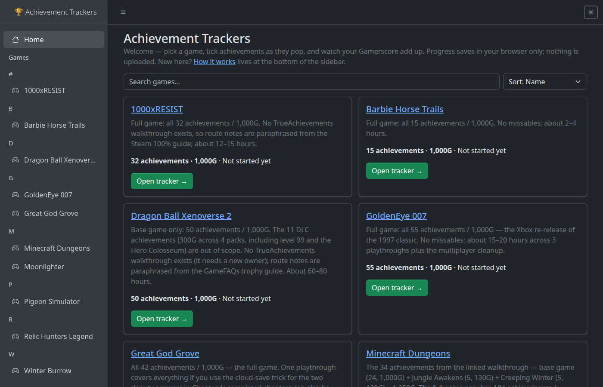
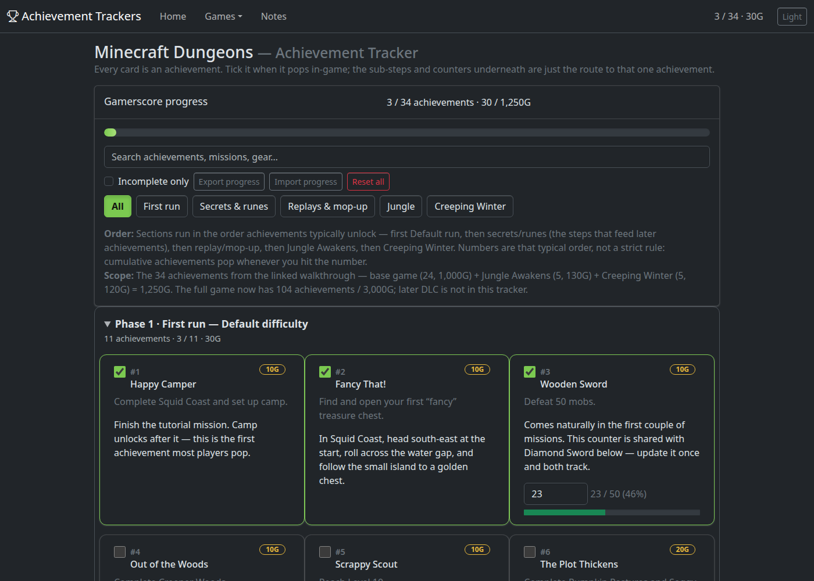
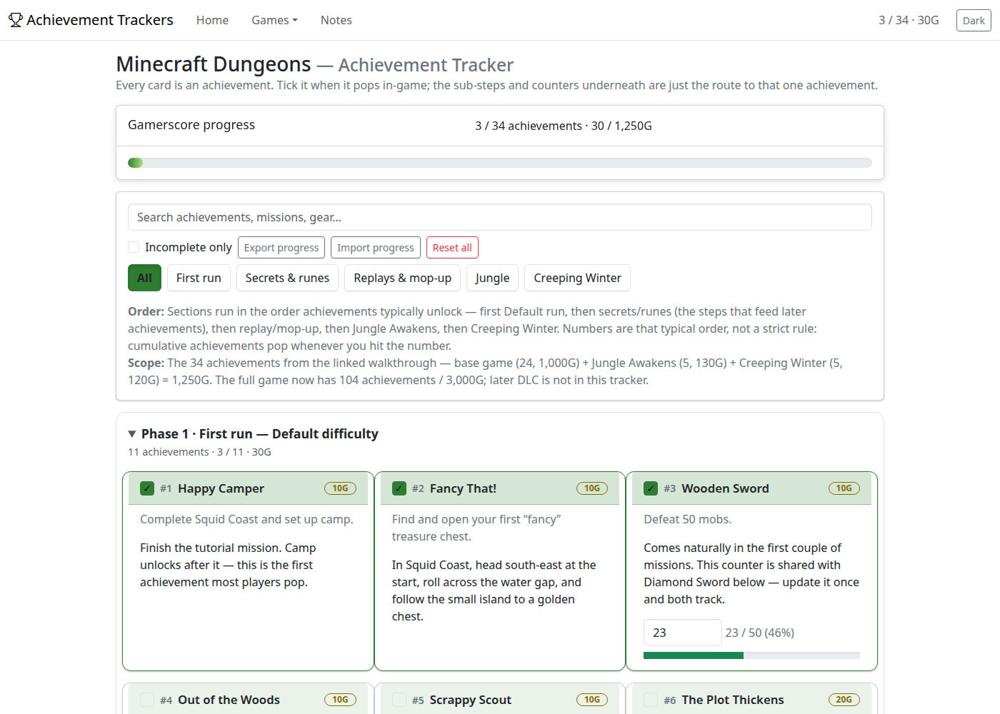
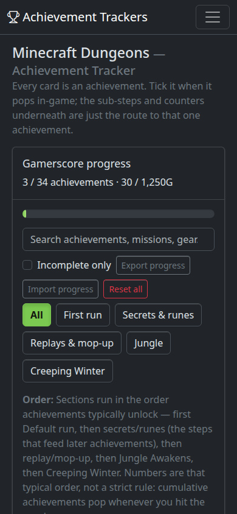
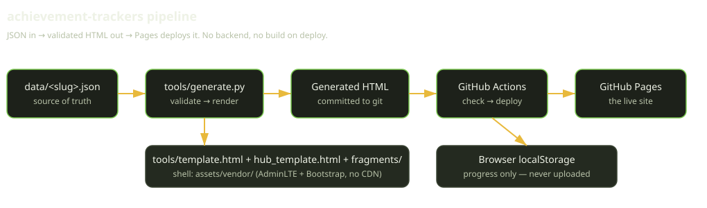

# achievement-trackers

Interactive achievement trackers, housed in one GitHub Pages site.
Every card *is* an achievement — its name, Gamerscore and requirement —
with the short route to that achievement underneath it. Achievements
are grouped and ordered by how they typically unlock, so you can work
through a game in order instead of hunting through a flat list.

**Live site:** https://enonymous1.github.io/achievement-trackers/

<!-- The demo GIF below is still commented out on purpose: it needs a
     real interaction recording (ticking, counting, theme toggle), not
     a mocked animation. Uncomment it when that capture exists.
     Every other screenshot here was captured from the real local app.
-->

<!--  -->

## What it looks like





The hub is the landing page: a welcome line, a how-it-works card, a
search box with a sort control beside it (name, completion,
achievements, started), and one card per game showing its achievement count,
Gamerscore total, and your saved progress on this browser. The footer
totals the whole library (currently: 14 games · 457 achievements ·
14,250G) and links to this repo.

Each game page has a Gamerscore progress bar, search, an
incomplete-only toggle, phase filters, and export / import / reset for
your progress. Ticking an achievement fills its steps and counters,
and unticking clears them; counters stop at their target with a
yes/no gate to go past it. The top bar stays frozen while scrolling
and carries the compact progress. Cards can carry notes, a Missable
pill, and screenshots or step-by-step slideshows. Progress saves in your browser only (localStorage, one
key per game); nothing is uploaded, and the hub can show progress
across games because they share the same Pages origin. Each page also
has an Xbox sync card (when a game is mapped) that ticks from your
Xbox data with your own key. A Privacy Dashboard import was tried
and dropped: the archive holds app usage, not achievement records —
see "We tried the Microsoft export" on the How it works page.

## Xbox sync setup (OpenXBL)

The sync card is built but dormant: it renders only for games whose
JSON carries an `xbox_title_id` and an `xbox_id` on every
achievement, and no game is mapped yet. No public source lists those
IDs, so they come from a live OpenXBL response — never guessed. To
map a game:

1. **Get an OpenXBL key:** sign in at xbl.io with the Microsoft
   account that owns the Xbox profile and create an API key.
2. **Find your XUID:** `GET https://api.xbl.io/api/v2/player/gamertag/<gamertag>`
   with header `X-Authorization: <key>` (or `GET /api/v2/account`
   for the key owner).
3. **Find the title ID:** `GET https://api.xbl.io/api/v2/player/titleHistory/<xuid>`
   and take the `titleId` from the entry for the game.
4. **Fetch the per-title achievements:** `GET https://api.xbl.io/api/v2/achievements/player/<xuid>/title/<titleId>`
   and save the full response. If it is paginated, fetch the
   following pages and merge the achievement entries into one file
   (an array, or an object with an `achievements` array).
5. **Map it:** `python tools/map_xbox.py --title-id <titleId> response.json`
   — it matches by name and refuses to write on any unmatched or
   ambiguous achievement. Review the diff (names, Gamerscore
   warnings) before continuing.
6. **Regenerate and commit:** `python tools/generate.py`, then
   `--check` and the tests, and commit the JSON and the generated
   HTML together. The sync card then appears on that game's page.
7. **Use it:** the card takes a gamertag and key (stored in that
   browser only, never in Export), shows a preview, and applies on
   Confirm — newly unlocked achievements and their sub-steps only,
   never unticks, never touches notes or counters. If the browser
   blocks the direct fetch, the card's paste-JSON fallback takes the
   same per-title response from step 4.

**Key safety, stated plainly:** a key committed to a public repo is
public, permanently — git history keeps it even after deletion, and
anyone holding it can burn the account's rate limit and query data
through it. OpenXBL keys carry no "only this gamertag" scope, and a
gamertag check in page JavaScript is cosmetic: anyone can edit the
script or call the API directly. So the key stays out of the repo.
Two safe shapes: (a) per-visitor keys — each visitor enters their
own key, which is the model the card uses; (b) if the published
site should show one person's progress with no key asked of
visitors, fetch it at build time in GitHub Actions with the key
stored in the repo's Settings → Secrets (never in a file) and
publish only the resulting achievement states — the key never
reaches the site.

## Description

This repo is a small static-site pipeline, not a web app with a
backend. The pipeline is:

1. **Data:** one JSON file per game in `data/<slug>.json` is the
   source of truth.
2. **Generator:** `tools/generate.py` validates that JSON (Gamerscore
   sums, unique ids, counter groups, non-empty requirement/route text,
   declared sources) and renders the pages.
3. **Pages:** the generated HTML is committed to the repo, and
   GitHub Actions deploys it to GitHub Pages. There is no runtime
   build step and no server.

The trade-off, stated plainly: a game page is **not** portable on its
own. It references the shared vendored shell under `assets/vendor/`,
so the repo — not a lone file — is the distribution unit. That is the
right shape for a Pages hub, and it is why generated pages are
committed rather than built on deploy.

**Current games:** Minecraft Dungeons — 34 achievements, 1,250G
(base game 24 / 1,000G + Jungle Awakens 5 / 130G + Creeping Winter 5 /
120G). The full game now has 104 achievements / 3,000G; later DLC is
deliberately out of scope for this tracker, and the page says so.
Great God Grove — 42 achievements, 1,000G, the full game in
walkthrough order (Grove Cove through the finale).
Barbie Horse Trails — 15 achievements, 1,000G, the full game in
story/roadmap order.
Pigeon Simulator — 10 achievements, 1,000G, the full game in
walkthrough order: tutorial gadget cheese, first missions, then
the upgrade grind.
Winter Burrow — 32 achievements, 1,000G, the full game in
walkthrough order across five sections (beginning, owl, recovery,
rebuilding, furnishings), with counters for the cumulative
crafting and gathering totals.
1000xRESIST — 32 achievements, 1,000G, the full game in story
order: chapters, the Orchard landmarks, the seven talk-to-
everyone sections (flagged missable), and all seven epilogue
endings with their light combinations. No TA walkthrough
exists, so route notes are paraphrased from the Steam 100%
guide.
GoldenEye 007 — 55 achievements, 1,000G, the full game in
walkthrough order: 20 story missions, 3 difficulty
completions, 21 cheat time trials, and 11 split-screen
multiplayer achievements (with step checklists for the
maps, weapon sets, and scenarios).
Relic Hunters Legend — 18 achievements, 1,000G, the full
game in story order: 13 chapters and adventures plus 5
progression achievements (new Hunter, levels 6 and 30
on a shared counter, first Relic, first Treasure Map).
No TA walkthrough exists, so chapter order follows a
completed playthrough's unlock sequence.
Wreckfest (Windows) — 20 achievements, 1,000G, the full
game: 5 career championships plus all career
challenges, ranks 10/25/50 on a shared counter,
vehicle collecting, the wrecking totals, the lawn
mower hour, and 20 multiplayer wins (private-lobby
boostable; AI wins don't count). No TA walkthrough
exists, so route notes are paraphrased from the Knoef
and Fuzionbyte trophy guides.
Dragon Ball Xenoverse 2 — 50 achievements, 1,000G, the
base game only (the 11 DLC achievements are out of
scope): 12 story sagas, 3 class tests, Parallel
Quests and Expert Missions, online wins, and the
Conton City cleanup, ending with the 0G completion
achievement. No TA walkthrough exists, so route
notes are paraphrased from the GameFAQs trophy
guide.
Moonlighter — 57 achievements, 1,000G, the full base
game in walkthrough order: Golem, Forest, Desert,
Tech and the finale, plus a New Game+ speedrun — two
playthroughs, seven missables (the four no-hit boss
kills, the janitor and careful-merchant runs, and the
speedrun). The Between Dimensions DLC has its own
achievements and is out of scope.
Police Simulator: Patrol Officers — 25 achievements,
1,000G, the full game in Steam-guide order: the five
first shifts, the Duty Star unlocks, then arrests,
first aid, towing, photography, and the radar — with
shared counters per system and no missables. No TA
walkthrough exists, so route notes are paraphrased
from the Steam 100% Achievement Guide. Names and
Gamerscore come from a saved copy of the TA
achievements page.
Firefighting Simulator: The Squad — 30 achievements,
1,000G, the full game in walkthrough order:
tutorials, the mission grind, multiplayer and
victims alongside, the five trucks and the ladder
tools, then the water and driving grinds last.
Shared counters per grind (missions 1/5/10/50/100,
multiplayer 1/10/30/50, victims 1/10/100/200,
water 1,000/10,000/100,000 litres, distance
50/100/1,000 km) and no missables. Names,
Gamerscore, and route notes come from saved
copies of the TA achievements page and the
single-page TA walkthrough.
Total Chaos — 37 achievements, 1,000G, the full
game in chapter order (Arrival through Resolve),
then the merciful run, the endings, combat,
crafting, and the collectibles. Six missables —
the five chapter variants and the good ending —
with step checklists on each; the good ending
and the full 45-journal set can't be done in one
playthrough. No counters: every achievement is a
one-time feat. No TA walkthrough exists, so route
notes are paraphrased from the Twinfinite
good-ending walkthrough and TA achievement
solutions. Names and Gamerscore come from a saved
copy of the TA achievements page.

## Prerequisites

- **Python 3.12** — for `tools/generate.py` and `tools/check_js.py`.
  No Python packages to install; the tools use the standard library
  only.
- **Node.js 20+** — only for `tools/check_js.py`, which runs
  `node --check` on the inline scripts in the generated pages.
  If you never touch the templates, you can skip Node and still run
  the generator.
- **Git** — for cloning and committing.
- A browser, for previewing. No other services, accounts, or API keys
  are needed.

## Installation

```sh
git clone https://github.com/enonymous1/achievement-trackers.git
cd achievement-trackers
```

There is nothing to install. Verify the checkout is clean and the
generated pages match the data:

```sh
python3 tools/generate.py --check
```

If that reports out-of-date outputs, run the generator (see Local
Development) and commit the result — never hand-edit a generated page.

## Local Development

### Preview the site

```sh
python3 -m http.server 8000
# hub:  http://127.0.0.1:8000/
# game: http://127.0.0.1:8000/minecraft-dungeons/
```

### Regenerate after editing data or templates

```sh
python3 tools/generate.py
```

The generator **fails** instead of shipping a wrong page: on a
Gamerscore sum mismatch against the declared `total_gs` / `total_count`,
a duplicate achievement or step id, a bad counter, missing
requirement/route text, a missing vendored shell asset, an unreplaced
template placeholder, or an absolute path in a generated page.

### Checks (also run in CI)

```sh
python3 -m unittest discover -s tools -v   # validator + rendering tests (stdlib only)
pip install ruff && ruff check tools/       # lint (line length 100, see pyproject.toml)
python3 tools/generate.py --check           # generated pages match the data, without writing
python3 tools/check_js.py                   # scripts pass node --check (requires Node)
```

### Adding a game

1. Copy `data/minecraft-dungeons.json` to `data/<slug>.json` and fill
   it in. The filename must match the `slug` field, and the slug must
   be URL-safe (`[a-z0-9][a-z0-9-]*`).
2. Run the generator, preview locally, and commit the JSON **and**
   the generated HTML together.

Schema, per game file:

- Top level: `slug`, `title`, `tagline`, `order_note`, `scope_note`,
  `total_gs`, `total_count`, `storage_key`, `sources` (each a `label`
  + `https://` URL). `total_gs` / `total_count` are the generator's
  check: if the achievements in the file do not sum/count to them,
  generation fails.
- `legacy_key` and `legacy_migration` are optional, for moving
  progress from an older tracker key (see the Dungeons file).
- Sections: `id`, `title`, optional `subtitle`, optional `intro`,
  `achievements`, `step_cards`. The first section is open by
  default; later sections start collapsed. If `subtitle` is set on
  an achievement section it replaces the computed
  "N achievements, XG" summary; otherwise that summary is computed.
- Achievements: `id`, `name`, `gs` (non-negative integer — a
  genuine 0G achievement exists), `req`, `how`,
  optional `steps` (`id`, `label`) — ticking every step auto-ticks
  the achievement, and ticking the achievement fills its steps
  and counters (unticking clears them) — and optional `counters` (`group`, `target`).
  Counters with the same `group` share one number across
  achievements, and different achievements in one group may have
  different targets (one shared value, several thresholds — e.g.
  mobs defeated feeds both a 50 and a 2,500 target).
  Optional `missable: true` renders a Missable pill (a choice or
  one-time window). Optional `media` lists screenshots/clips under
  the route note: `type` image/video, `src` an `assets/` path
  (files live under `assets/media/<slug>/`, referenced as
  `assets/...` in the JSON) or an `https://` URL; a remote video
  must be a media file or a YouTube URL (embedded
  privacy-enhanced). `credit` renders an "Image: …" overlay
  on the image, shown on hover (and in the viewer caption);
  guide images carry their source as credit, and a
  failed load swaps in a placeholder explaining why instead of a
  broken-image icon. `full` (optional) is a larger version the
  image opens in an on-page viewer (a new tab if scripts are
  off). Media must be real captures, never mocked.
  Optional `slideshow` is an ordered step-by-step guide for
  the card (same entry shape as media, images only), rendered
  one slide at a time with Previous/Next buttons; slide images
  open in the same viewer, where Previous/Next step through
  the slideshow too (or tap the left/right side of the
  image). Card headers shrink long names toward a floor and
  equalise per row, so bodies start on one line.
- `step_cards`: walkthrough steps that are *not* achievements
  themselves (secret missions, runes) — `title`, `how`, `steps`.
- Filter buttons: each section may carry its own `filter_label`
  (preferred). A section without one falls back to a short map in
  `tools/generate.py` (`FILTER_LABELS`, keyed by section id), then
  to the section title up to the first `·`, or the id itself.
  New section types should get a `filter_label` in the JSON, not a
  code change.
- The formal schema is `data/schema.json` (human-readable contract;
  enforcement lives in `tools/generate.py`).

> **Do not run `python3 tools/generate.py --game <slug>` before
> committing.** That mode regenerates the hub plus one game page
> only, leaving other game pages untouched. Always run the full
> generator before committing.

### Project layout

```
achievement-trackers/
  index.html                  # hub / landing page (generated)
  <slug>/index.html           # one tracker per game (generated)
  how-it-works/index.html     # How it works page (generated)
  assets/vendor/              # AdminLTE shell, vendored — no CDN
  assets/css/sidebar.css      # shared left-sidebar layout
  assets/css/tracker-cards.css # shared card language (game + How demos)
  assets/js/theme-toggle.js   # shared theme toggle (see below)
  assets/js/sidebar-state.js  # sidebar collapsed/open persistence
  assets/favicon.svg          # trophy favicon
  data/<slug>.json            # the game data — edit this
  data/schema.json            # human-readable schema for game data
  docs/architecture.svg       # pipeline diagram
  docs/screenshots/           # real captures from the local app
  tools/generate.py           # validator + renderer
  tools/config.py             # repo URL, shell versions, vendor list
  tools/fragments/            # card markup (achievement, step, counter)
  tools/check_js.py           # node --check for scripts
  tools/test_generate.py      # stdlib unit tests
  tools/template.html         # the tracker page template
  tools/hub_template.html     # the hub page template
  tools/how_template.html     # the How it works page template
  .github/workflows/check.yml # shared checks, called by CI + Pages
  .github/workflows/ci.yml    # checks on push / PR
  .github/workflows/pages.yml # check, then deploy to Pages
  pyproject.toml              # ruff configuration
  CHANGELOG.md                # notable changes, by date
  LICENSE                     # MIT
```

### Troubleshooting

| Symptom | Cause / fix |
|---|---|
| `generate --check` lists out-of-date outputs | Run `python3 tools/generate.py` and commit the JSON + HTML together. Do not edit the generated HTML by hand. |
| `declared total_gs … does not match sum` | A `gs` value in the JSON is wrong, or `total_gs` is stale. Fix the data, not the check. |
| `duplicate achievement/step id` | Ids must be unique across the whole game file, not just within a section. Rename the newer one. |
| `missing vendored shell asset` | `assets/vendor/` is incomplete (e.g. a partial clone). Restore it; the generator refuses to ship pages with broken shell links. |
| `check_js.py: node not found` | Install Node 20+, or skip the JS check locally — CI still runs it. |
| Progress lost / "Not started yet" after clearing data | Progress lives in localStorage only. Clearing site data, switching browsers, or using private mode starts fresh. Export progress first if it matters. |

## Architecture



One JSON file per game is validated and rendered by a single Python
generator into committed HTML. The shell — AdminLTE 4.10.0 +
Bootstrap 5.3.8 + Bootstrap Icons 1.11.3, vendored under
`assets/vendor/` (see `THIRD_PARTY_NOTICES.md` there) — is shared by
every page, in a left-sidebar layout: the sidebar holds the
"Achievement Trackers" brand, Home, a Games header with the games
grouped under A–Z letter headers, and a How it works link anchored to the
bottom; the sidebar collapses with the hamburger in the top bar,
and that state persists across pages on its own localStorage key.
The top bar is frozen while scrolling and carries the compact
progress (text plus a thin bar) and the icon light/dark toggle, on
the shared `at-theme` localStorage key. The generator computes the relative
asset prefix per page (`./assets/` from the hub, `../assets/` from a
game or How page), and refuses to emit absolute paths.

Pages carry no backend and no tracking. The only state is localStorage:
one key per game for ticks, steps, counters and notes, read by the hub
to show per-game progress. Card markup lives in HTML fragments under
`tools/fragments/` (not in Python strings), shell versions and the
repo URL live in `tools/config.py`, and the tracker JS is inline in
each generated page while the theme toggle and sidebar-state
persistence are shared files (`assets/js/theme-toggle.js`,
`assets/js/sidebar-state.js`) loaded by all three templates. The
card styling itself is shared too (`assets/css/tracker-cards.css`),
so the How page's live demo cards — real cards rendered from the
Dungeons data through the same fragments, with demo-prefixed ids
and a sandboxed demo script that never touches localStorage — look
exactly like the real ones.

## Deployment

Deployment is GitHub Actions, not branch publishing:

1. Push to `main` (or run the `Pages` workflow manually via
   `workflow_dispatch`).
2. The `Pages` workflow first calls the shared `check.yml` workflow
   (unit tests, ruff, `generate.py --check`, `check_js.py`), then —
   on `main` only — stages only site files (`index.html`, `assets/`,
   and each game directory, derived from the data slugs) into `_site/`
   and deploys with `configure-pages` → `upload-pages-artifact`
   (`_site/`) → `deploy-pages`, under the `github-pages` environment
   with `contents: read`, `pages: write`, `id-token: write`
   permissions and a `pages` concurrency group that never cancels an
   in-flight deploy.
3. The `CI` workflow calls the same shared checks on every push and
   pull request to `main`, so the two workflows cannot drift apart.

One-time repo setup (after the first push): Settings → Pages →
Build and deployment → Source: **GitHub Actions**. The site is then
https://enonymous1.github.io/achievement-trackers/.

After pushing, also set the repo's social preview image (Settings →
General → Social preview, 1280×640) — GitHub uses it on every link
share, and no README setting can replace it. Suggested image: trophy
icon + "Achievement Trackers" + the current library totals.

## Content rules

- Do not copy a walkthrough's full text. Route notes are short
  paraphrases, and every game page links back to its sources.
- Achievement names, requirements and Gamerscore are facts from the
  achievement list; unlock order, multi-mission pop points, RNG
  gates, and which secrets feed which achievements need human
  judgement per game — the generator automates rendering and
  checking, not that research, and it must not auto-scrape a guide
  site.
- Scope is stated on each page. If a tracker covers only part of a
  game's achievements (e.g. Dungeons: the walkthrough's 34 of the
  full 104), say so on the page — do not present a partial tracker
  as a complete one.

## Contributing

Contributions are welcome, with one rule that matters more than the
rest: **data first, never generated HTML.** Edit `data/<slug>.json`
(or a template, if you are changing presentation for all games), run
the full generator, run both checks, preview locally, and commit the
JSON and the generated HTML together. Pull requests that hand-edit a
generated page will fail `--check` in CI and will not be merged.

If you add a game, include its sources, state its scope honestly, and
keep route notes to short paraphrases — see Content rules above.

## License

MIT — see [LICENSE](LICENSE). The vendored shell under
`assets/vendor/` carries its own MIT licences; see
[assets/vendor/THIRD_PARTY_NOTICES.md](assets/vendor/THIRD_PARTY_NOTICES.md).
